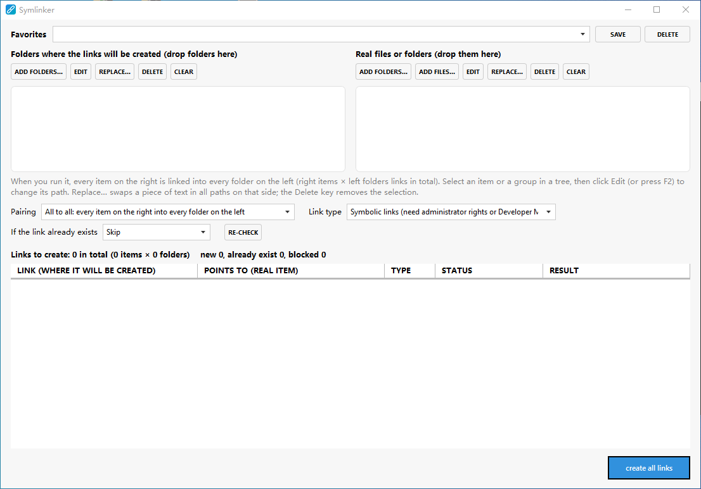

# Symlinker

[English](README.md) | [简体中文](README.zh-CN.md)

A small Windows tool for creating **symbolic links, junctions and hard links in bulk**.

You keep two lists. The left one holds the folders where links should be created, and the right one holds the real files and folders. Symlinker shows every link it is about to create, then creates them all in one go. Typical use: a shared data folder that has to appear inside several program folders, or the same set of files linked into every new version of an application.



## Features

- **Two lists, one click.** Drop files and folders onto either side, or use the *Add* buttons. A folder counts as a single item and its contents are never read.
- **Tree view grouped by parent folder.** Select an item or a group, then edit its path (`F2`), delete it (`Delete`), or use *Replace…* to swap a piece of text in every path on that side. Handy when you move a whole set to a different drive or version folder.
- **Two ways to pair the lists:**
  - **All to all:** every item on the right is linked into every folder on the left (M × N links).
  - **Manual pairs:** you decide which items go into which folders. Select a folder (or a whole group) on the left and an item (or group) on the right, then click *Pair selected*. The table below lists exactly the links that will be created.
- **Preview before anything happens.** The table lists every planned link with its status: ready, already linked, name already exists, source missing, destination missing, overlap, and so on.
- **Conflict policy** for names that already exist: *skip*, *overwrite* (removes only links, files and empty folders, and refuses a non-empty real folder), or *back up and replace* (the old item is renamed to `.bak`, `.bak1`, `.bak2`, …).
- **Safe to re-run.** Links that already point to the right target are recognized and left alone. Overlapping paths (a link that would equal its target, or sit inside it) are refused.
- **Favorites.** Save the whole setup (both lists, pairs, link type and policy), reload it later and edit it. They are stored in a `data` folder next to `Symlinker.exe`, so nothing is scattered around the system. If that folder cannot be written (for example under `C:\Program Files`), `%AppData%\Symlinker` is used instead. When you update by unzipping a new version, keep the `data` folder.
- **Update check.** At startup (at most once a day) Symlinker looks for a newer release on GitHub and Gitee. If there is one, it tells you once and shows a red dot next to the *About* button until you update. *About → Check for updates* checks on demand. Only release information is read; nothing is downloaded or installed automatically, and a failed check is ignored silently.
- **Light and dark themes.** The window follows the Windows light/dark mode and accent color.
- **Nine languages:** English, Deutsch, Español, Français, हिन्दी, Italiano, 日本語, Português and 中文. The language follows the Windows display language, and other languages fall back to English.

## Link types

| Option | Folders | Files | Needs |
|---|---|---|---|
| **Symbolic links** | symbolic link | symbolic link | administrator rights **or** Windows Developer Mode |
| **Junction (folders) + hard link (files)** | junction | hard link | nothing special; hard links must stay on the same drive |

Symlinker does not elevate itself, so drag and drop from Explorer keeps working. If creating a symbolic link fails for lack of privileges, the app tells you. Either turn on Developer Mode (in Windows Settings, under *For developers*), start Symlinker as administrator, or switch to the junction + hard link option.

## Download

Get the latest build from the Releases page on [GitHub](https://github.com/DwgSearch/Symlinker/releases) or [Gitee](https://gitee.com/h1985/Symlinker/releases).

## Requirements

- Windows 10 or 11
- [.NET 10 SDK](https://dotnet.microsoft.com/download) to build, or the .NET 10 Desktop Runtime to run a build

## Build and run

```
dotnet build Symlinker.csproj
dotnet run --project Symlinker.csproj
```

You can also open the project in Visual Studio and press F5.

### Trying another language

The UI language follows Windows. To see another language without changing the system setting, pass `--lang` with a culture name:

```
Symlinker.exe --lang ja
dotnet run -- --lang de
```

Supported codes are `en`, `de`, `es`, `fr`, `hi`, `it`, `ja`, `pt` and `zh`.

## Usage in short

1. Add the **folders where the links should be created** on the left.
2. Add the **real files and folders** on the right.
3. Choose the pairing (*All to all* or *Manual pairs*), the link type and what to do when a name already exists.
4. Check the table, then click **Create all links**.

Nothing is changed on disk until you click that button.

## Project layout

| File | Purpose |
|---|---|
| `MainWindow.xaml(.cs)` | The window: two trees, options, plan table |
| `PathGrouping.cs` | Cleans paths and groups them by parent folder (no disk scanning) |
| `LinkPlanner.cs` | Builds the list of links (all to all or manual pairs) and pre-checks each one |
| `LinkService.cs` | Creates the links and applies the conflict policy |
| `LinkSetStore.cs` | Reads and writes favorites as JSON |
| `UpdateChecker.cs`, `AppInfo.cs` | Update check against the GitHub and Gitee release feeds; repository names |
| `AppSettings.cs` | Program settings (`settings.json`) |
| `DataPaths.cs` | Chooses where `sets.json` and `settings.json` are stored |
| `AboutWindow.xaml(.cs)` | About box with links and the update check |
| `Properties/Resources*.resx` | UI strings, one file per language |

### Adding or changing translations

All UI text lives in `Properties/Resources.resx` (English) and `Properties/Resources.<lang>.resx`. To add a string, add an entry with the same name to every file, then add the matching property to `Resources.Designer.cs` (Visual Studio does this automatically). Windows error messages shown after a failed link come from the operating system and follow the Windows language.

## Publishing a release (for maintainers)

The update check reads the latest published release of `DwgSearch/Symlinker` on GitHub and `h1985/Symlinker` on Gitee (see `AppInfo.cs` to change the names) and compares its tag with the running version.

The script `scripts/release.ps1` does all of it:

```
$env:GITEE_TOKEN = "<your Gitee private token>"
.\scripts\release.ps1 -Version 0.2.0 -DryRun   # build and zip only
.\scripts\release.ps1 -Version 0.2.0           # commit, tag, push, publish on both sites
```

By hand, it comes down to: raise `<Version>` in `Symlinker.csproj`, then create a release on GitHub and/or Gitee whose tag is the same number, for example `v0.2.0`, and attach the build. Drafts and pre-releases are ignored.

If both sites have a release, the newer one wins, and a site that cannot be reached is skipped.

## Known limitations

- Windows only. It is a WPF application.
- Hard links cannot cross drives, and junctions only work for folders on local drives.
- Translations other than English and Chinese were machine-assisted and have not been reviewed by native speakers. Corrections are welcome.

## Contributing

Issues and pull requests are welcome. Please include your Windows version and the exact error text when reporting a failed link.

## License

<!-- Choose a license and add a LICENSE file, then name it here. -->
