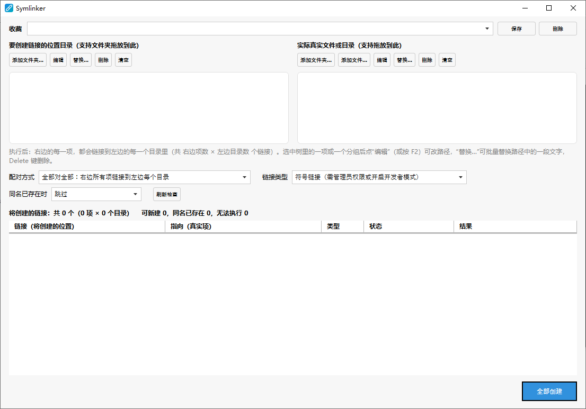

# Symlinker

[English](README.md) | 简体中文

一款 Windows 小工具，用来**批量创建符号链接、目录联接（Junction）和硬链接**。

你维护两个列表：左边是要创建链接的位置目录，右边是真实的文件和文件夹。Symlinker 会先列出所有将要创建的链接，确认后一次性全部创建。典型用途：同一份共享数据要出现在多个程序目录里，或者每次新版本软件都要把同一批文件链接进去。



## 功能

- **两个列表，一键执行。** 把文件和文件夹拖到任意一侧，或用“添加”按钮。文件夹只算一项，不会读取里面的内容。
- **按上级目录分组的目录树。** 选中一项或一组，可以编辑路径（`F2`）、删除（`Delete`），也可以用“替换…”批量替换该侧所有路径中的一段文字。整批换盘符或换版本目录时很方便。
- **两种配对方式：**
  - **全部对全部：** 右边每一项都链接到左边每个目录（M × N 个链接）。
  - **手动配对：** 自己指定哪些项链接到哪些目录。在左边选一个目录（或一整组），在右边选一项（或一整组），点“配对所选项”。下方表格列出的就是实际会创建的链接。
- **执行前先预览。** 表格列出每个计划中的链接及其状态：可新建、已链接、同名已存在、源不存在、目标目录不存在、路径重叠等。
- **同名冲突策略：** *跳过*；*覆盖*（只删除链接、文件和空文件夹，遇到非空的真实文件夹会拒绝）；*备份后替换*（旧项改名为 `.bak`、`.bak1`、`.bak2` …）。
- **可重复执行。** 已经指向正确目标的链接会被识别并跳过。路径重叠的情况（链接等于目标，或位于目标内部）会被拒绝。
- **收藏。** 保存整套设置（两个列表、配对、链接类型、冲突策略），以后加载并继续编辑。保存在程序旁边的 `data` 文件夹里，不会散落到系统各处；如果该文件夹不可写（例如装在 `C:\Program Files` 下），则改用 `%AppData%\Symlinker`。解压新版本更新时，请保留 `data` 文件夹。
- **检查更新。** 启动时（每天最多一次）会到 GitHub 和 Gitee 查找更新的发行版。发现新版本时弹窗提示一次，并在“关于”按钮旁显示红点，直到你更新为止。在“关于”窗口里也可以点“检查更新”随时检查。只读取发行版信息，不会自动下载或安装；检查失败时静默忽略。
- **明暗主题。** 窗口跟随 Windows 的明暗模式和主题色。
- **九种语言：** English、Deutsch、Español、Français、हिन्दी、Italiano、日本語、Português、中文。界面语言跟随 Windows 显示语言，其他语言显示英文。

## 链接类型

| 选项 | 文件夹 | 文件 | 要求 |
|---|---|---|---|
| **符号链接** | 符号链接 | 符号链接 | 管理员权限，**或**开启 Windows 开发者模式 |
| **联接（文件夹）+ 硬链接（文件）** | 联接 | 硬链接 | 无特殊要求；硬链接必须在同一磁盘上 |

Symlinker 不会自动提权，所以从资源管理器拖放仍然可用。如果因为权限不足而无法创建符号链接，程序会提示。可以开启开发者模式（在 Windows 设置的“开发者选项”里）、以管理员身份运行 Symlinker，或者改用“联接 + 硬链接”。

## 下载

最新版本见 [GitHub](https://github.com/DwgSearch/Symlinker/releases) 或 [Gitee](https://gitee.com/h1985/Symlinker/releases) 的 Releases 页面。

## 系统要求

- Windows 10 或 11
- 编译需要 [.NET 10 SDK](https://dotnet.microsoft.com/download)；只运行编译好的程序需要 .NET 10 桌面运行时

## 编译和运行

```
dotnet build Symlinker.csproj
dotnet run --project Symlinker.csproj
```

也可以用 Visual Studio 打开项目，按 F5 运行。

### 查看其他语言的效果

界面语言跟随 Windows。想不改系统设置就看其他语言，可以用 `--lang` 参数加语言代码：

```
Symlinker.exe --lang ja
dotnet run -- --lang de
```

支持的代码：`en`、`de`、`es`、`fr`、`hi`、`it`、`ja`、`pt`、`zh`。

## 简要用法

1. 在左边添加**要创建链接的位置目录**。
2. 在右边添加**真实的文件和文件夹**。
3. 选择配对方式（*全部对全部* 或 *手动配对*）、链接类型，以及同名已存在时怎么处理。
4. 检查表格，然后点**创建所有链接**。

点这个按钮之前，磁盘上不会有任何改动。

## 项目结构

| 文件 | 作用 |
|---|---|
| `MainWindow.xaml(.cs)` | 主窗口：两棵目录树、选项、计划表格 |
| `PathGrouping.cs` | 清理路径并按上级目录分组（不扫描磁盘） |
| `LinkPlanner.cs` | 生成链接列表（全部对全部或手动配对），并预检每一项 |
| `LinkService.cs` | 创建链接并执行冲突策略 |
| `LinkSetStore.cs` | 以 JSON 读写收藏 |
| `UpdateChecker.cs`、`AppInfo.cs` | 通过 GitHub 和 Gitee 的发行版信息检查更新；仓库名称 |
| `AppSettings.cs` | 程序设置（`settings.json`） |
| `DataPaths.cs` | 决定 `sets.json` 和 `settings.json` 存放在哪里 |
| `AboutWindow.xaml(.cs)` | “关于”窗口：链接和检查更新 |
| `Properties/Resources*.resx` | 界面文字，每种语言一个文件 |

### 添加或修改翻译

所有界面文字都在 `Properties/Resources.resx`（英文）和 `Properties/Resources.<语言>.resx` 里。新增文字时，在每个文件里添加同名条目，再在 `Resources.Designer.cs` 里加上对应的属性（Visual Studio 会自动生成）。链接创建失败时显示的 Windows 错误原因由操作系统提供，跟随系统语言。

## 发布新版本（维护者）

检查更新读取 GitHub 上 `DwgSearch/Symlinker` 和 Gitee 上 `h1985/Symlinker` 的最新发行版（要改仓库名请看 `AppInfo.cs`），并把它的标签与当前版本比较。

脚本 `scripts/release.ps1` 可以完成全部步骤：

```
$env:GITEE_TOKEN = "<你的 Gitee 私人令牌>"
.\scripts\release.ps1 -Version 0.2.0 -DryRun   # 只编译并打包
.\scripts\release.ps1 -Version 0.2.0           # 提交、打标签、推送，并在两个站点发布
```

手动做的话就是：提高 `Symlinker.csproj` 里的 `<Version>`，然后在 GitHub 和/或 Gitee 上创建发行版，标签用同一个版本号，例如 `v0.2.0`，并附上编译好的程序。草稿和预发布版会被忽略。

两个站点都有发行版时取较新的一个，访问不了的站点会被跳过。

## 已知限制

- 仅支持 Windows（WPF 程序）。
- 硬链接不能跨磁盘；联接只适用于本地磁盘上的文件夹。
- 除英文和中文外，其他语言的译文由机器辅助翻译，没有经过母语者审校，欢迎指正。

## 参与贡献

欢迎提交 Issue 和 Pull Request。报告链接创建失败时，请附上 Windows 版本和完整的错误文字。

## 许可证

<!-- 选定许可证并添加 LICENSE 文件，然后在这里写明。 -->
